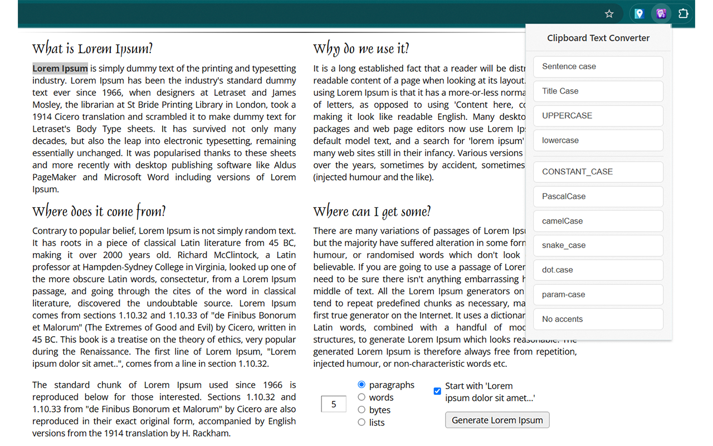
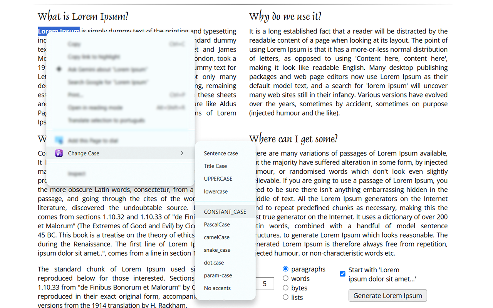

# Change Case - Conversor de Texto

Extensão para navegadores baseados em Chromium que converte textos da área de transferência ou selecionados na página entre diversos estilos de capitalização e formatação.

## Funcionalidades Principais

* **Diversos estilos de capitalização:** Converte para Sentence case, Title Case, UPPERCASE, lowercase, CONSTANT_CASE, PascalCase, camelCase, snake_case, dot.case e param-case.
* **Title-Kebab-Case (Chicago):** Formatação de títulos hifenizados aplicando as regras do Chicago Manual of Style (CMOS) para português e inglês.
* **Remoção de acentos:** Opção dedicada para remover diacríticos e acentuações mantendo os caracteres base.
* **Menu de contexto:** Acesso rápido através do botão direito do mouse sobre qualquer texto selecionado na página, substituindo em campos editáveis ou copiando diretamente.
* **Atalhos de teclado:** Teclas de atalho pré-configuradas para conversões instantâneas (`Alt+Shift+U`, `Alt+Shift+L`, `Alt+Shift+T`, `Alt+Shift+C`).
* **Internacionalização (i18n):** Suporte nativo a múltiplos idiomas (Inglês, Português do Brasil, Português de Portugal, Espanhol e Francês).

## Pré-requisitos

* Navegador Google Chrome, Microsoft Edge, Brave ou qualquer navegador compatível com extensões Manifest V3.

## Instalação e Configuração

1. Clone ou baixe este repositório para o seu computador.
2. Abra o navegador e acesse a página de gerenciamento de extensões (`chrome://extensions/` no Chrome ou `edge://extensions/` no Edge).
3. Ative o **Modo do desenvolvedor** no canto superior direito.
4. Clique no botão **Carregar sem compactação** (Load unpacked) e selecione a pasta raiz deste projeto.

## Como Usar

### Pelo Popup da Extensão:
1. Copie o texto desejado para a área de transferência (`Ctrl+C`).
2. Clique no ícone da extensão na barra de ferramentas do navegador.
3. Clique no botão com o formato desejado (ex.: `Title-Kebab-Case`, `camelCase`, `CONSTANT_CASE`).
4. O texto convertido é copiado automaticamente de volta para a sua área de transferência com feedback visual.

### Pelo Menu de Contexto:
1. Selecione qualquer texto em uma página web.
2. Clique com o botão direito e navegue até **Change Case**.
3. Escolha o estilo de formatação desejado.

## Capturas de Tela

## Histórico de Versões

### v2.2 - 2026-10-26
- Adicionada a conversão **Title-Kebab-Case (Chicago)** com regras de capitalização do *The Chicago Manual of Style* para português e inglês.
- Atualização do menu de contexto e do popup com novo botão e atalho.
- Suporte a internacionalização (i18n) em 5 idiomas (pt_BR, pt_PT, en, es, fr).
- Inclusão da Política de Privacidade detalhada e documentação completa.

## Contribuindo

Sugestões e correções são bem-vindas. Abra uma Issue ou envie um Pull Request.

## Licença

Este projeto é distribuído sob os termos da licença **GNU General Public License v3.0 (GNU GPLv3)**. Consulte o arquivo [LICENSE](LICENSE) para obter o texto completo da licença.

## Autor

Rodrigo Peçanha

